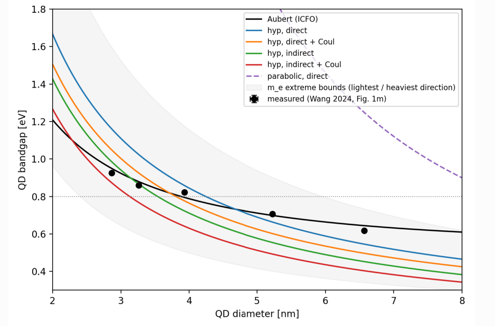
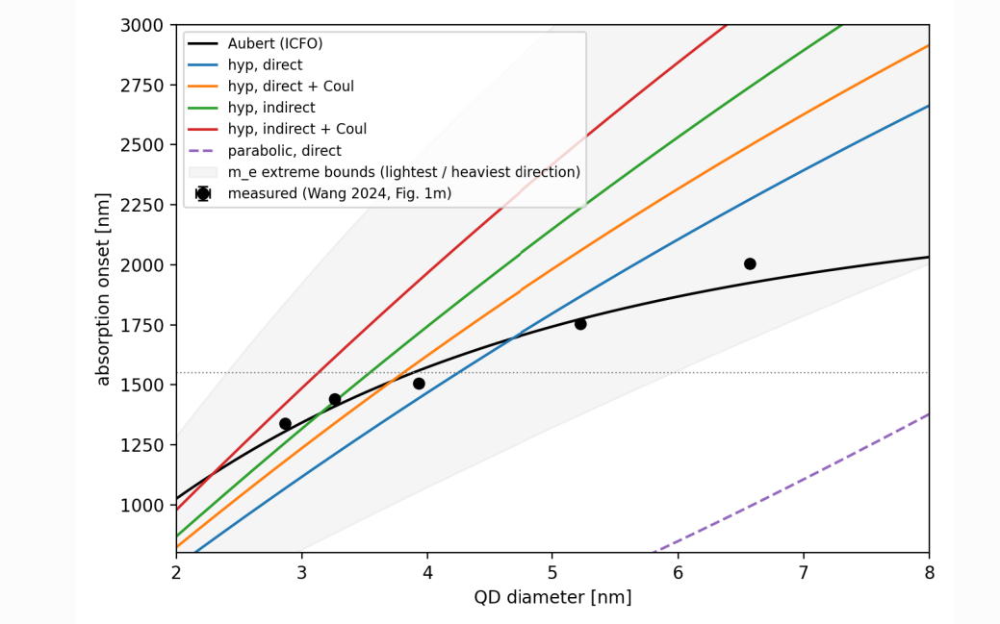

# Size-Dependent Bandgap of β-Ag₂Te Quantum Dots for 1550 nm Photodetection from First-Principles Inputs

**Part of:** FMCW LiDAR with a colloidal-QD photodetector (MSc thesis)
**Tools:** VASP (HSE06 + SOC + D3), VASPKIT, SeeK-path, Python (NumPy, SciPy, Matplotlib)

---

## Abstract

Ag₂Te colloidal quantum dots (QDs) are a heavy-metal-free option for short-wave infrared photodetectors, but choosing the QD size for a target wavelength usually relies on empirical sizing curves. Here, the size needed for 1550 nm absorption is predicted from a model whose bulk inputs come from our own first-principles calculations. The band structure of monoclinic β-Ag₂Te (P2₁/c) was computed with the HSE06 hybrid functional including spin–orbit coupling, giving an indirect gap of **0.129 eV** and a direct gap at Γ of **0.178 eV**. Fitting the band edges gives a very light, strongly non-parabolic electron (**mₑ = 0.033 m₀**, Kane model) and a heavy hole (**mₕ = 2.48 m₀**). These were used in a Brus model with a hyperbolic (Kane) conduction band. Against five measured QD bandgaps from the literature, the best model (direct gap + Coulomb term) gives an RMS deviation of **0.097 eV** and predicts a **3.81 nm** diameter for 1550 nm, within 2% of the experimental sizing curve (3.88 nm). The standard parabolic model fails by about 3 eV RMS, showing that conduction-band non-parabolicity is essential for Ag₂Te QDs.

## Key results

| Quantity | Value |
|---|---|
| Indirect gap (HSE06+SOC) | 0.1286 eV (VBM on B–Γ, CBM at Γ) |
| Direct gap at Γ | 0.178 eV |
| Electron mass (harmonic mean, Kane) | 0.033 m₀ (range 0.0159–0.129 m₀) |
| Hole mass (harmonic mean, parabolic) | 2.48 m₀ (range 2.23–2.78 m₀) |
| Best model vs. experiment (RMS) | 0.097 eV |
| **QD diameter for 1550 nm** | **3.81 nm** (sizing curve: 3.88 nm) |

<p align="center">
  
  
</p>
<p align="center"><em><b>Figure 1.</b> Left: QD bandgap versus diameter for all models, the experimental sizing curve and the measured points, with the 1550 nm line (0.800 eV). The gray band shows the result with the lightest or heaviest electron mass. Right: the same comparison as absorption onset wavelength.</em></p>

---

## 1. Methods

### 1.1 DFT calculations

Calculations used density functional theory [1, 2] in VASP [3, 4] with the projector augmented-wave method [5, 6]. The Kohn–Sham equations are

```math
\left[-\frac{\hbar^2}{2m}\nabla^2 + V_\text{eff}(\mathbf r)\right]\psi_i(\mathbf r) = \varepsilon_i\,\psi_i(\mathbf r),
\qquad V_\text{eff} = V_\text{ext} + V_\text{H} + V_\text{xc}.
```

Because PBE [7] strongly underestimates the gap of narrow-gap materials like Ag₂Te, all results use the **HSE06** hybrid functional [8, 9], which mixes 25% exact exchange at short range (ω = 0.2 Å⁻¹):

```math
E_\text{xc}^\text{HSE06} = \tfrac14 E_x^\text{HF,SR}(\omega) + \tfrac34 E_x^\text{PBE,SR}(\omega) + E_x^\text{PBE,LR}(\omega) + E_c^\text{PBE}.
```

**Spin–orbit coupling** [10] was included in all electronic-structure calculations, since it is strong for heavy Ag and Te and reshapes the band edges. **Van der Waals** interactions were added with Grimme's D3 correction [11] with Becke–Johnson damping [23] (`IVDW = 12`).

The monoclinic β-Ag₂Te cell (P2₁/c) was fully relaxed (positions, shape, volume) with HSE06+D3. SOC was then included in the band-structure calculation on this geometry. The plane-wave cutoff was 500 eV, the Brillouin zone was sampled with a Γ-centred 5 × 7 × 4 mesh, the electronic convergence was 10⁻⁶ eV, and the relaxation stopped when all forces were below 0.02 eV/Å.

### 1.2 Band structure and convergence checks

Hybrid-functional bands were computed with the **zero-weight k-point method** [12], starting from a converged PBE+SOC WAVECAR, with the path split over several runs. The high-symmetry path follows Hinuma et al. [14] (VASPKIT [13], cross-checked with SeeK-path).

Since VASP's energy criterion does not test zero-weight eigenvalues, two extra checks were written in Python:
1. **Γ-point consistency:** every Γ point on the path must give identical eigenvalues (nine bands around the gap).
2. **Run-to-run consistency:** eigenvalues compared with an earlier, independent run.

### 1.3 Effective masses

Band energies near the edges were fitted with the Kane (non-parabolic) dispersion [15]

```math
E\left(1 + \frac{E}{E_0}\right) = \frac{\hbar^2 k^2}{2m^*},
\qquad m^*(E) = m^*\left(1 + \frac{2E}{E_0}\right),
```

rewritten as the linear model $k^2 = aE + bE^2$, so that $m^*/m_0 = (\hbar^2/2m_0)\,a$ and $E_0 = a/b$. The electron was fitted with the Kane model along the four path segments leaving Γ, and the heavy hole with a parabola. Fits were repeated for 0.3, 0.6 and 1.0 eV windows. Direction-dependent masses were combined with the harmonic mean, as is done for the conductivity mass [18]:

```math
\frac{1}{m^*} = \frac{1}{N}\sum_{i=1}^{N}\frac{1}{m_i}.
```

### 1.4 Quantum-confinement model

The QD gap follows the Brus model [19] with a hyperbolic conduction band [16]:

```math
E_\text{QD}(R) = E_g + E_e + E_h - \frac{1.786\,e^2}{4\pi\varepsilon_0\varepsilon_\infty R},
\qquad C_i = \frac{\hbar^2\pi^2}{2m_i R^2},
```

```math
E_h = C_h, \qquad E_e\left(1 + \frac{E_e}{E_g}\right) = C_e \;\Rightarrow\; E_e = \frac{E_g}{2}\left(\sqrt{1 + \frac{4C_e}{E_g}} - 1\right).
```

All bulk inputs ($E_g$, $m_e$, $m_h$) are our own HSE06+SOC results. The only external input is $\varepsilon_\infty = 16$ [20]. Six variants were compared: hyperbolic or parabolic, direct or indirect gap, with or without the Coulomb term.

### 1.5 Validation

Five measured (diameter, gap) points were digitized from Wang et al. [20] with WebPlotDigitizer [22], and the experimental sizing curve of the Aubert form [21] (E₀ = 0.53 eV, d₀ = 10 nm, ε = 16, α = 0.7) was reproduced as a reference. Agreement is reported as the mean and RMS of $\Delta E_j = E_\text{model}(d_j) - E_{\text{meas},j}$.

---

## 2. Results and discussion

### 2.1 Structure and band structure

The relaxed cell is a = 7.93 Å, b = 4.38 Å, c = 8.95 Å, β ≈ 122.4° (V ≈ 262 ų). β-Ag₂Te is a narrow-gap semiconductor with an **indirect gap of 0.1286 eV**: the CBM is at Γ, and the VBM lies on B–Γ at k = (0, 0, 1/3). The **direct gap at Γ is 0.178 eV**, larger by the 0.049 eV depth of a small dip in the top valence band at Γ.

Both convergence checks passed: the Γ points agree to **0.00 meV**, and the two independent runs differ by at most **0.61 meV**, which is far below the gap and the confinement energies.

### 2.2 Effective masses

| Carrier | Model | Lightest (m₀) | Heaviest (m₀) | Harmonic mean (m₀) |
|---|---|---|---|---|
| Electron (CBM, Γ) | Kane | 0.0159 | 0.129 | **0.033** |
| Hole (VBM) | Parabolic | 2.23 | 2.78 | **2.48** |

The electron mass is nearly the same for the 0.6 and 1.0 eV windows (0.0329 and 0.0330 m₀), so the Kane model describes the band consistently. The hole is about 75× heavier, so the electron provides almost all of the confinement. For a 4 nm dot, $C_e$ ≈ 2.85 eV is reduced to $E_e$ ≈ 0.63 eV by the hyperbolic band, while $E_h$ ≈ 0.04 eV and the Coulomb term is ≈ −0.08 eV.

### 2.3 Model comparison

| Model | Mean ΔE (eV) | RMS (eV) | d for 1550 nm (nm) |
|---|---|---|---|
| Experimental sizing curve (reference) | +0.007 | 0.023 | 3.88 |
| **Hyperbolic, direct gap + Coulomb** | **−0.017** | **0.097** | **3.81** |
| Hyperbolic, indirect gap | −0.070 | 0.114 | 3.54 |
| Hyperbolic, direct gap | +0.064 | 0.135 | 4.24 |
| Hyperbolic, indirect gap + Coulomb | −0.151 | 0.165 | 3.13 |
| Parabolic, direct gap | +2.535 | 2.981 | 8.62 |

The small RMS of the sizing curve (0.023 eV) confirms the digitization and implementation. The best model uses the **direct gap**, which also makes physical sense: absorption across the indirect gap needs a phonon and is weak, so the strong onset is set by the direct transition at Γ.

The **parabolic model fails**, predicting 5.8 eV for a 2.9 nm dot that measures 0.93 eV. In a 4 nm dot the electron sits ≈ 0.63 eV above the band edge, where its mass is ≈ 0.27 m₀, about 8× the band-edge value.

### 2.4 QD size for 1550 nm

The model built only from our DFT inputs predicts **3.81 nm**, compared with **3.88 nm** from the experimental curve (Δ = 0.07 nm, ≈ 2%). This is consistent with the measured 3.93 nm dot (0.823 eV, ≈ 1507 nm).

### 2.5 Limitations

- **Slope mismatch:** the deviations change sign systematically (+0.12 → −0.12 eV from small to large dots), so the model is steeper than experiment. Part of the good agreement at 1550 nm comes from the curves crossing near 0.8 eV.
- **Mass anisotropy** is the largest uncertainty. Using the lightest or heaviest mass moves the onset of a 4 nm dot from 1072 to 2490 nm (gray band, Fig. 1). A tensor built from four path directions was not positive-definite.
- $\varepsilon_\infty = 16$ is an external value that was not measured specifically for Ag₂Te.
- The model assumes a sphere, infinite walls and a two-band Kane picture with $E_0 = E_g$, and the DFT values are for 0 K while the measurements were at room temperature.

### 2.6 Next steps

1. Compute the full effective-mass tensor from six independent directions around Γ and use its principal masses.
2. Replace $\varepsilon_\infty$ with an in-house value from optical DFT, so that the model needs no external input.
3. Pass the predicted QD absorption to the FDTD photodetector model ([QD-Photodetector-Simulations](https://github.com/elvinbegen/QD-Photodetector-Simulations)).

---

## Repository structure

```text
Ag2Te-DFT-Simulations/
├── README.md                          ← this report
├── figures/                           ← figures used above
├── monoclinic/                        ← β-Ag₂Te (P2₁/c), main results
│   ├── 01_Geometry_Optimization/      ← HSE06 + D3 relaxation inputs
│   └── 02_Band_Calculation/
│       ├── HSE06_Band_Calculation/    ← zero-weight HSE06+SOC band run inputs
│       └── PBE_Band_Calculation/      ← PBE+SOC bands (starting WAVECAR) + plot script
├── scripts/                           ← data-processing utilities
└── tetragonal_archived/               ← early PBE exploration (see its README)
```

Only VASP inputs (INCAR, KPOINTS, POSCAR) and processed results are stored. Large outputs (WAVECAR, CHGCAR, vasprun.xml) are not included.

## References

1. P. Hohenberg and W. Kohn, *Phys. Rev.* **136**, B864 (1964).
2. W. Kohn and L. J. Sham, *Phys. Rev.* **140**, A1133 (1965).
3. G. Kresse and J. Furthmüller, *Phys. Rev. B* **54**, 11169 (1996).
4. G. Kresse and J. Furthmüller, *Comput. Mater. Sci.* **6**, 15 (1996).
5. P. E. Blöchl, *Phys. Rev. B* **50**, 17953 (1994).
6. G. Kresse and D. Joubert, *Phys. Rev. B* **59**, 1758 (1999).
7. J. P. Perdew, K. Burke and M. Ernzerhof, *Phys. Rev. Lett.* **77**, 3865 (1996).
8. J. Heyd, G. E. Scuseria and M. Ernzerhof, *J. Chem. Phys.* **118**, 8207 (2003).
9. A. V. Krukau et al., *J. Chem. Phys.* **125**, 224106 (2006).
10. S. Steiner et al., *Phys. Rev. B* **93**, 224425 (2016).
11. S. Grimme, J. Antony, S. Ehrlich and H. Krieg, *J. Chem. Phys.* **132**, 154104 (2010).
12. VASP Wiki, "Band-structure calculation using hybrid functionals".
13. V. Wang et al., *Comput. Phys. Commun.* **267**, 108033 (2021).
14. Y. Hinuma et al., *Comput. Mater. Sci.* **128**, 140 (2017).
15. E. O. Kane, *J. Phys. Chem. Solids* **1**, 249 (1957).
16. Y. Wang, A. Suna, W. Mahler and R. Kasowski, *J. Chem. Phys.* **87**, 7315 (1987).
17. L. D. Whalley, J. M. Frost, B. J. Morgan and A. Walsh, *Phys. Rev. B* **99**, 085207 (2019).
18. S. M. Sze and K. K. Ng, *Physics of Semiconductor Devices*, 3rd ed., Wiley (2007).
19. L. E. Brus, *J. Chem. Phys.* **80**, 4403 (1984).
20. Y. Wang et al., *Nat. Photonics* **18**, 236 (2024). <!-- TODO: full author list -->
21. Aubert et al., *Nano Lett.* (2022). <!-- TODO: authors, volume, pages -->
22. A. Rohatgi, WebPlotDigitizer, https://automeris.io/
23. S. Grimme, S. Ehrlich and L. Goerigk, *J. Comput. Chem.* **32**, 1456 (2011).

---

*Computations were performed at TÜBİTAK ULAKBİM, High Performance and Grid Computing Center (TRUBA).*
